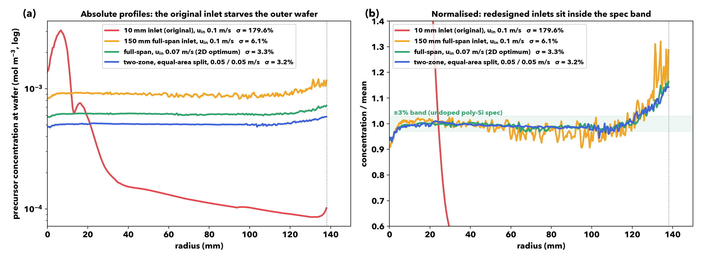
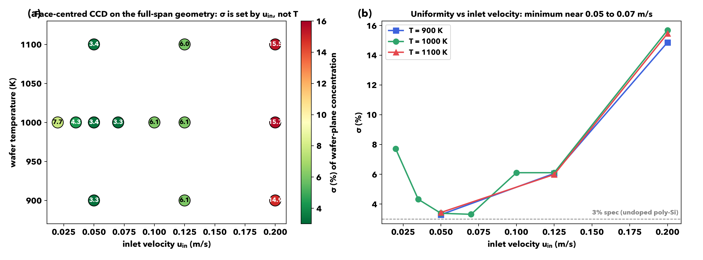
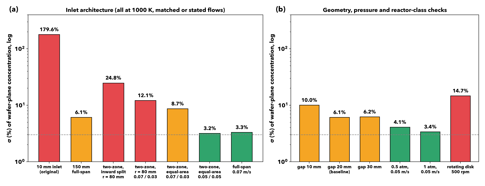
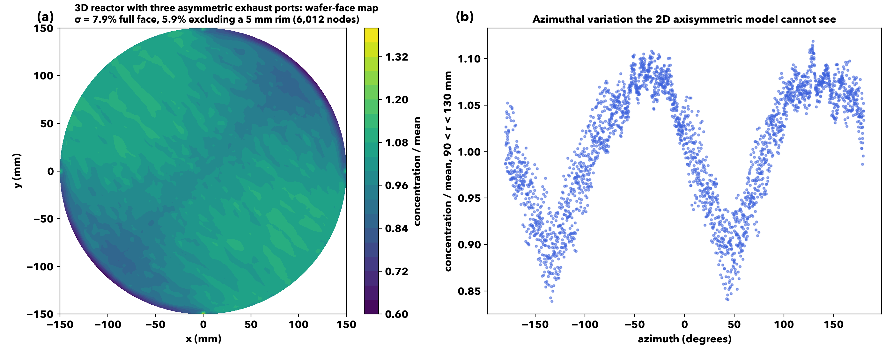
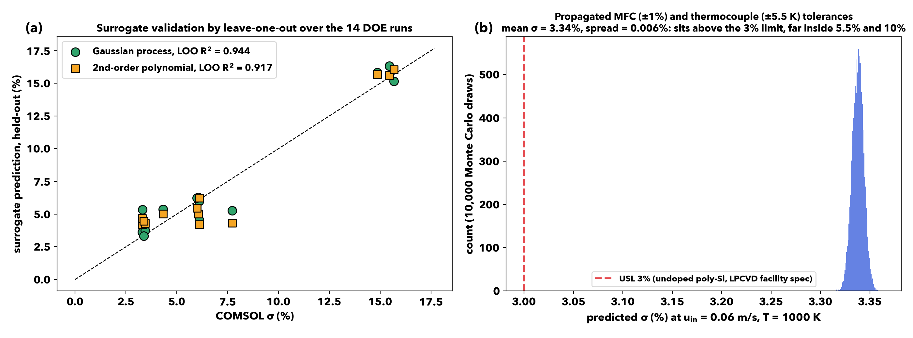

<p align="center"><a href="https://soham-cheme.github.io/CVD-Reactor-Uniformity-COMSOL/"></a></p>

<p align="center"><b><a href="https://soham-cheme.github.io/CVD-Reactor-Uniformity-COMSOL/">Open the live page</a></b> · scroll-driven 3D: the reactor with the wafer-plane concentration as a height map morphing from 179.6 % to 6.1 % to 3.3 % as the inlet widens and slows, the reactor cross-section assembling, and every figure as an interactive 3D scene</p>

<div align="center">


</div>

<div align="center">

[](https://www.comsol.com)
[](#model)
[-0b1220?style=flat-square)](#design-of-experiments)
[](#process-capability)
[](analysis)
[](docs/CLAIMS.md)

**Soham Kavathekar** · MS Chemical & Biomolecular Engineering, University of Pennsylvania
[stg3719@seas.upenn.edu](mailto:stg3719@seas.upenn.edu) · [LinkedIn](https://www.linkedin.com/in/soham-kavathekar-cheme)

</div>

---

## Results first

A finite-element model of an atmospheric-pressure CVD reactor depositing polycrystalline silicon from a silane-like precursor onto a **300 mm wafer**, used to find out why the deposit was grossly non-uniform and to redesign the gas inlet until it was not. The work follows the sequence a process engineer would use on a real tool: diagnose the transport regime, fix the geometry, run a designed experiment, fit a surrogate, and estimate process capability against a published film-thickness spec.

Every number in this README is computed from the COMSOL exports in [`data/`](data) by the scripts in [`analysis/`](analysis); `./reproduce.sh` regenerates all of them and the claim-by-claim audit is in [`docs/CLAIMS.md`](docs/CLAIMS.md). The three `.mph` model files are in [`models/`](models).

| | Before (10 mm inlet) | After (150 mm full-span, 0.07 m/s) |
|---|---|---|
| Within-wafer non-uniformity σ (coefficient of variation of precursor concentration at the wafer plane, r ≤ 138 mm) | **179.6 %** | **3.3 %** |
| Wafer coverage (radius where concentration falls to 10 % of peak) | 16.9 % | 91.9 % |
| Regime | mass-transfer-limited, precursor starved beyond r ≈ 25 mm | near-uniform supply; edge rise from exhaust proximity |

<p align="center"></p>

### Results at a glance

| Result | Value | Source |
|---|---|---|
| Non-uniformity σ, 10 mm inlet (the "before" case) | 179.6 %, coverage 16.9 %, precursor consumed within 25 mm, Da ≈ 13 | `data/old_runs/run1_baseline_radial_profile.csv`, `analysis/full_analysis.py` |
| Inlet widened to 150 mm, same flow | 6.1 %, coverage 91.9 % | `data/fullspan_baseline_u01_T1000_radial_profile.csv` |
| 14-run face-centred CCD optimum, 0.07 m/s | 3.3 % | `data/fullspan_run12_u007_T1000_radial_profile.csv` |
| Temperature sensitivity at 0.05 m/s, 900 / 1000 / 1100 K | 3.29 / 3.38 / 3.44 % | `cvd_results.json` `doe` |
| Gaussian-process surrogate, leave-one-out R² | 0.944 (second-order polynomial 0.917) | `analysis/real_cpk_pipeline_v4.py` |
| 10,000-draw Monte Carlo with MFC ±1 % and thermocouple ±5.5 K at 0.06 m/s | expected σ 3.34 %, spread 0.006 % | same |
| 3D model with three asymmetric exhaust ports | 5.9 % (5 mm rim excluded), 7.9 % full face, 6,012 nodes | `data/wafer_3D_radial_profile.csv`, `analysis/wafer_3D_sigma.py` |

---

## Model

| Item | Choice | Basis |
|---|---|---|
| Geometry | 2D axisymmetric chamber, 300 mm wafer, 20 mm wafer-to-inlet gap, sidewall exhaust slit | US 6,022,811 (Mitsubishi Electric) gas head to wafer diameter ratio; gap swept 10/20/30 mm as a factor |
| Physics | Laminar flow, heat transfer in fluids, transport of a dilute species, coupled | steady state |
| Carrier gas | N₂, T-dependent μ (Sutherland), C<sub>p</sub> (NIST-JANAF) and k (Lemmon & Jacobsen 2004) | sourced per property; viscosity re-derived by hand |
| Precursor | generic species with silane kinetics: surface rate constant k<sub>s</sub> from Hashimoto et al. (1990), Arrhenius; diffusivity D = 2.0×10⁻⁵ m² s⁻¹ (298 K) × (T/298)^1.75 | Han et al. 2024 base value, Fuller temperature exponent checked against Chapman-Enskog |
| Wafer boundary | first-order surface consumption, flux = −k<sub>s</sub>·c | deposition-rate proxy; thickness profile is a linear scaling of c(r) under the frozen-field assumption |
| Operating window | u<sub>in</sub> 0.02 to 0.20 m s⁻¹, T<sub>wafer</sub> 900 to 1100 K, 1 atm | APCVD conditions; k<sub>s</sub> at 900 K is a ~70 K extrapolation of the published range and is labelled as such |

The precursor is a silane-like species with reaction and transport parameters from the silane CVD literature, and that is the phrase used throughout.

---

## What was found

### 1. The original inlet was the problem, not the chemistry

With a 10 mm central inlet the Damköhler number (surface consumption over convective supply) sat above 10: the precursor was consumed within the first ~25 mm of radius and the outer 83 % of the wafer saw almost nothing (σ = 180 %, coverage 17 %). Widening the inlet to the wafer diameter, the ratio the Mitsubishi patent uses, brought σ to 6.1 % and coverage to 92 % at the same flow. Nothing else changed.

### 2. Inlet velocity controls uniformity; wafer temperature does not

A face-centred central composite design over u<sub>in</sub> and T<sub>wafer</sub> (14 COMSOL runs on the full-span geometry) shows σ falling from 15.7 % at 0.20 m s⁻¹ to 3.3 % at 0.07 m s⁻¹ and rising again below 0.035 m s⁻¹, while changing T<sub>wafer</sub> by ±100 K moves σ by less than 0.2 percentage points at any velocity. Velocity and temperature are decoupled, which means throughput (set by T through k<sub>s</sub>) can be tuned without spoiling uniformity.

<p align="center"></p>

### 3. Two-zone inlets help only when the split is placed correctly

Splitting the inlet at r = 80 mm (an "inward" split) and biasing flow to the outer zone gave σ = 24.8 % at matched total flow, worse than the single full-span inlet. Splitting at the **equal-area radius** (106.07 mm) recovered 8.7 % with the same 0.07/0.03 velocity pair and 3.2 % with equal zone velocities. The equal-area split is the neutral starting point recommended in the methodology notes, not a claimed optimum.

<p align="center"></p>

The right-hand panel shows the sensitivity checks: a 10 mm gap degrades σ to 10 %, 30 mm changes little, halving pressure at low velocity is mildly worse than 1 atm, and a rotating-disk configuration at 500 rpm is a different reactor class that does not transfer to this geometry (14.7 %).

### 4. 3D with asymmetric exhaust ports: what 2D cannot see

A 3D model with three discrete exhaust ports (a real reactor is built that way) reproduces the radial trend and resolves an azimuthal ripple of about ±10 % at mid-radius, tied to the port positions. The wafer-face coefficient of variation is **7.9 % over the full face and 5.9 % excluding a 5 mm edge rim** (6,012 surface nodes), a surface statistic reported alongside the radial σ of the 2D runs.

<p align="center"></p>

### 5. Process capability

A Gaussian-process surrogate fitted to the 14 DOE runs validates at **leave-one-out R² = 0.944** (a second-order polynomial gives 0.917). Propagating sourced equipment tolerances through it (mass-flow controller ±1 % of setpoint, Type K class 2 thermocouple ±5.5 K at 1000 K) with 10,000 Monte Carlo draws at u<sub>in</sub> = 0.06 m s⁻¹ gives a predicted σ of 3.34 % with a spread of only 0.006 %. Against the University of Waterloo QNC LPCVD facility specs (3 % for undoped poly-Si, 10 % for doped), the design sits just **above** the tight 3 % limit and far inside the 10 % one.

<p align="center"></p>

**Scope and assumptions.** The Monte Carlo spread is propagated input uncertainty through a deterministic model, the standard way to estimate a process window before a tool exists; the spec is the published LPCVD figure for the same chemistry family.

---

## Design of experiments

The DOE was generated with pyDOE3 (`analysis/generate_doe_v2.py`), a face-centred CCD over u<sub>in</sub> (0.05 to 0.20 m s⁻¹) and T<sub>wafer</sub> (900 to 1100 K), centred on the validated full-span baseline, and extended with additional axial points down to 0.02 m s⁻¹ once the optimum was seen to lie below the design centre. A benchmark at 3.41 m s⁻¹ failed to converge and defines the upper limit of the valid region. Every run is an exported wafer-plane profile in `data/`; `analysis/full_analysis.py` recomputes σ and coverage for all of them in one call.

## Sourcing discipline

Thirteen modelling questions were tracked to closure before the redesign was trusted; ten were resolved with citations, two are proprietary and handled as declared simplifications, one (wafer rotation) was deliberately kept out because the only available numbers belong to a different reactor class. The full table is in [`docs/Open_Questions_Resolved.md`](docs/Open_Questions_Resolved.md); the working plan, including what was verified and what was only hypothesised, is in [`docs/CVD_Action_Plan_2D_3D.md`](docs/CVD_Action_Plan_2D_3D.md).

**Scope and assumptions.** Steady-state wafer-plane concentration is the deposition proxy (the frozen-field approximation, under which thickness σ equals concentration σ); kinetics are single-mechanism Arrhenius surface consumption; the study optimised uniformity, with precursor utilisation (0.17 % in the baseline) left as the next objective; the 3D result is one configuration.

## How to run

```bash
git clone https://github.com/Soham-ChemE/CVD-Reactor-Uniformity-COMSOL.git
cd CVD-Reactor-Uniformity-COMSOL
python -m venv .venv && source .venv/bin/activate
pip install -r requirements.txt
./reproduce.sh      # σ and coverage for every export, 3D wafer statistics, surrogate + Monte Carlo, figures, live-page assets
python docs/build_assets.py --snap --qa --lighthouse   # static fallbacks for the 3D body scenes, both-theme screenshots, Lighthouse
```

`reproduce.sh` runs `analysis/full_analysis.py`, `analysis/wafer_3D_sigma.py`, `analysis/real_cpk_pipeline_v4.py`, `make_cvd_figs.py` (which also writes `cvd_results.json`) and `docs/build_assets.py`. No COMSOL licence is needed: every script reads the exports in `data/`. The `.mph` files open in COMSOL Multiphysics 6.4 or later. To view the live page locally, open `docs/index.html` in a browser; it needs no build step.

```
CVD-Reactor-Uniformity-COMSOL/
├── reproduce.sh     one-command reproduction
├── models/          CVD_Reactor_Run1_Baseline.mph, CVD_Reactor_SingleZone_Complete*.mph
├── data/            COMSOL exports: wafer-plane profiles, temperature profiles, 3D wafer surface, DOE design
│   └── old_runs/    original 10 mm inlet geometry (the "before" case)
├── analysis/        σ / coverage, DOE generation, surrogate + Monte Carlo Cpk, growth approximation
├── docs/            live page (index.html, build_assets.py, CLAIMS.md), methodology notes and the sourcing table
├── figures/         generated figures
└── make_cvd_figs.py
```

## Citation

```bibtex
@misc{kavathekar2026cvd,
  author = {Kavathekar, Soham},
  title  = {CVD reactor uniformity: inlet redesign, designed experiment and process-capability analysis for poly-Si deposition on a 300 mm wafer (COMSOL)},
  year   = {2026},
  url    = {https://github.com/Soham-ChemE/CVD-Reactor-Uniformity-COMSOL}
}
```

## Framing for different audiences

For semiconductor tool and process roles this is exactly what it looks like: a showerhead-class APCVD uniformity study on a 300 mm silicon wafer. For battery-manufacturing roles the hardware does not transfer (electrode coating is roll-to-roll or fluidised-bed), but the method does: identify the transport regime with a Damköhler number, fix the geometry that sets it, then use a designed experiment and a validated surrogate to map the process window before touching the tool.
